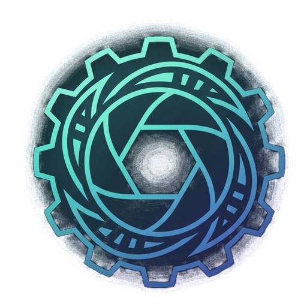

# Mecatube

<p align="center">
  
</p>

<p align="center">
  <strong>Estudio de producción de videos stickman con IA</strong><br />
  Guion, voz en off, ilustraciones y animaciones en un solo flujo de trabajo.
</p>

---

## Qué es

Mecatube es una aplicación para Windows que te ayuda a crear videos de personajes stickman: escribe el guion con DeepSeek, genera la voz en off, crea las ilustraciones y animaciones con Google Flow, y organiza todo en una sola ventana.

Para conectarse con DeepSeek y Flow usa una pequeña extensión de Chrome (incluida aquí).

## Descargar

| Qué | Enlace |
| --- | --- |
| **Aplicación para Windows** | [Descargar Mecatube.exe](https://github.com/EdwinEstrella/mecatube/releases/latest/download/Mecatube.exe) |
| **Extensión para Chrome** | [Descargar extension.zip](https://github.com/EdwinEstrella/mecatube/releases/latest/download/extension.zip) |
| Todas las versiones | [Ver versiones](https://github.com/EdwinEstrella/mecatube/releases) |

## Instalar la app paso a paso

1. Descarga **Mecatube.exe** con el enlace de arriba.
2. Haz doble clic en el archivo descargado.
3. Si Windows muestra **"Windows protegió su PC"**, es normal: la app aún no tiene firma digital de pago. Haz clic en **Más información** y luego en **Ejecutar de todas formas**.
4. Elige la carpeta de instalación (o deja la que aparece) y pulsa **Instalar**.
5. Al terminar, abre **Mecatube** desde el acceso directo del escritorio o del menú Inicio.

## Instalar la extensión en Chrome paso a paso

1. Descarga **extension.zip** con el enlace de arriba.
2. Descomprímelo en una carpeta que **no vayas a borrar ni mover** (por ejemplo `Documentos\Mecatube-Extension`). Chrome usa esa carpeta cada vez que se abre.
3. En Chrome escribe `chrome://extensions` en la barra de direcciones y pulsa Enter.
4. Activa **Modo de desarrollador** (interruptor arriba a la derecha).
5. Pulsa **Cargar descomprimida** y selecciona la carpeta donde descomprimiste el zip (la que contiene el archivo `manifest.json`).
6. Opcional: haz clic en el icono de puzle de Chrome y fija **Mecatube Bridge** para tenerlo a la mano.

> No borres la carpeta de la extensión: si lo haces, Chrome la desactivará.

**Para actualizar la extensión:** descarga el zip nuevo, descomprímelo sobre la misma carpeta (reemplazando los archivos), ve a `chrome://extensions` y pulsa el botón de recargar de la extensión.

## Primeros pasos

1. Abre Chrome y entra en [chat.deepseek.com](https://chat.deepseek.com) e inicia sesión.
2. En otra pestaña abre [flow.google.com](https://flow.google.com) e inicia sesión.
3. Abre Mecatube. Si la extensión está bien instalada, la app mostrará que está **conectada**.
4. Empieza un chat nuevo y sigue los pasos de la app.

## Actualizar

- **La app:** pulsa el botón **Actualizar** en la barra superior. Cuando haya una versión nueva dirá "Actualizar a vX.Y.Z"; púlsalo, espera la descarga y luego pulsa "Reiniciar y actualizar".
- **La extensión:** se actualiza a mano, como se explica arriba.

## Problemas frecuentes

- **La extensión aparece desconectada y los botones no funcionan:** comprueba que Chrome esté abierto, que la extensión esté activada en `chrome://extensions` y que tengas abiertas las pestañas de DeepSeek y Flow con la sesión iniciada. Recarga la extensión si hace falta.
- **Windows dice "Windows protegió su PC":** pulsa **Más información** y después **Ejecutar de todas formas**.
- **Flow pide resolver un captcha:** resuélvelo en la pestaña de Flow; Mecatube continúa solo cuando termines.

## Apoya el proyecto

Si Mecatube te es útil, puedes apoyar su desarrollo con una donación.

[](https://buy.stripe.com/dRm8wI8Hk0wq3Y692vcEw0h)

Enlace directo: https://buy.stripe.com/dRm8wI8Hk0wq3Y692vcEw0h

## Publicar la extensión en la Chrome Web Store

Consulta la guía en [docs/chrome-web-store.md](docs/chrome-web-store.md).

---

<details>
<summary><strong>Para desarrolladores</strong></summary>

```bash
npm install              # instala dependencias
npm run dev              # app en modo desarrollo
npm run dist             # genera el instalador en release/
npm run pack:extension   # genera release/extension.zip
```

**Publicar una versión:**

1. Sube la versión en `package.json` (por ejemplo `0.1.1`) y haz commit.
2. Ejecuta `npm run dist` y `npm run pack:extension`.
3. Crea un tag `vX.Y.Z` y una release en GitHub.
4. Adjunta a la release: `Mecatube.exe`, `Mecatube.exe.blockmap`, `latest.yml` y `extension.zip`. Los nombres no llevan versión: el actualizador de la app lee la versión desde `latest.yml`, y los enlaces de este README siempre apuntan a la última release.

</details>
